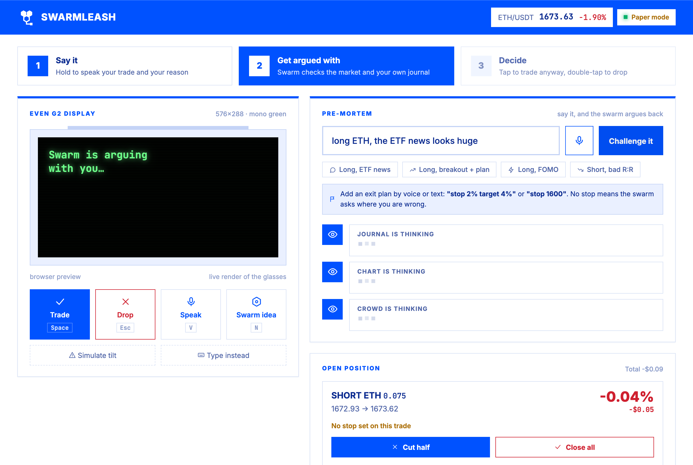
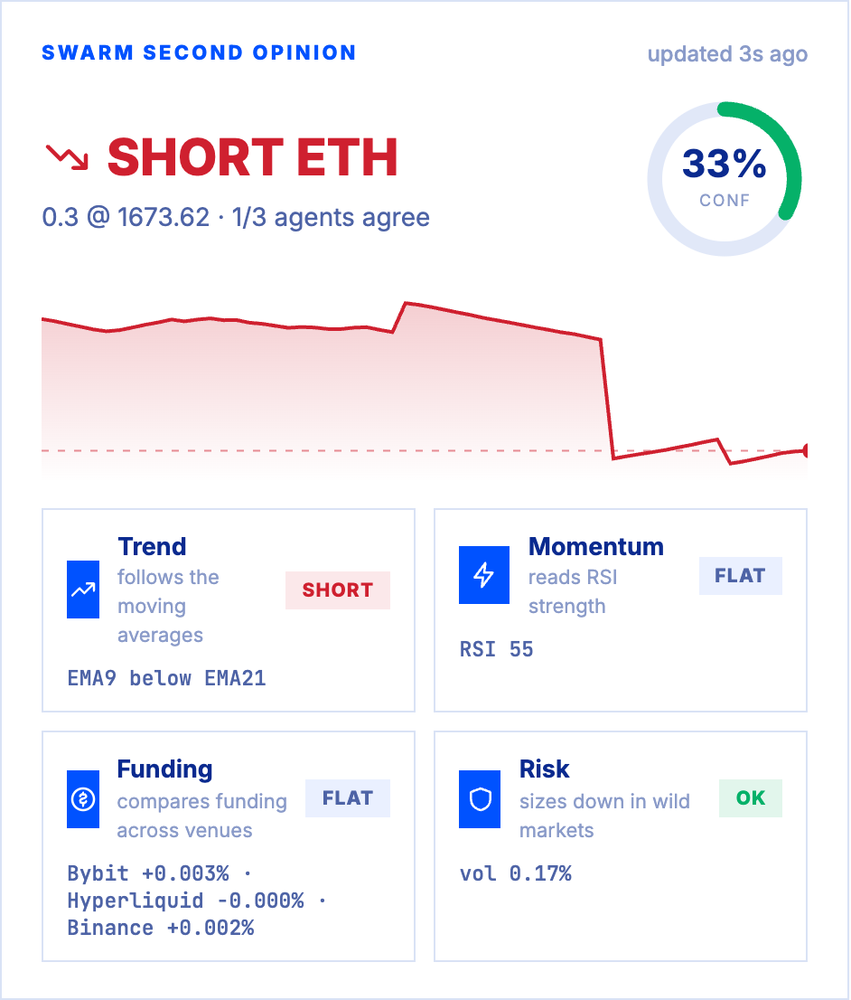
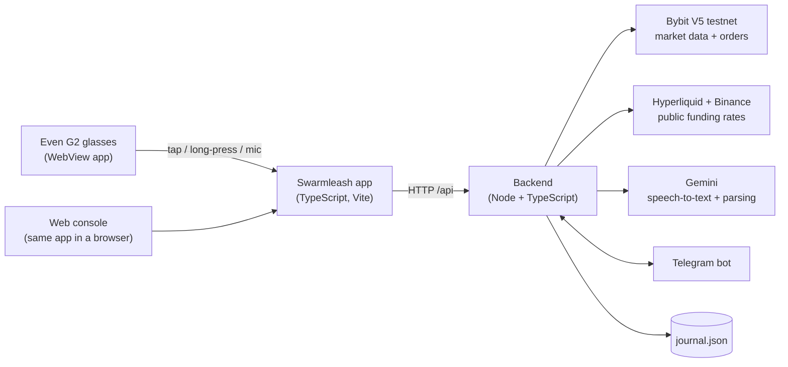

<p align="center">
  
</p>

<h3 align="center">Say your trade. A swarm argues back.</h3>

<p align="center">
  A pre-mortem for traders, built for <b>Even G2 smart glasses</b>.<br>
  Speak the trade, see the strongest case against it, then decide in one tap.
</p>

<p align="center">
  
  
  
  
  
  
</p>

<p align="center">
  
</p>

---

## Contents

- [Overview](#overview)
- [Meet the agents](#meet-the-agents)
- [How it works](#how-it-works)
- [Demo walkthrough](#demo-walkthrough)
- [Features](#features)
- [Architecture](#architecture)
- [Quick start](#quick-start)
- [Configuration](#configuration)
- [Controls](#controls)
- [API reference](#api-reference)
- [Telegram bot](#telegram-bot)
- [Safety](#safety)
- [Packaging for Even Hub](#packaging-for-even-hub)
- [Project structure](#project-structure)
- [Limitations](#limitations)
- [Hackathon notes](#hackathon-notes)

## Overview

Most trading tools show you more data. Swarmleash does the opposite: it checks **you**.

You say what you are about to do and why: *"Long ETH, the ETF news looks huge."* Before the order goes out, a swarm of specialist agents plays devil's advocate. It checks live market conditions **and your own trading journal**, then the glasses show the single strongest reason not to trade, for example *"Your 5 news trades: 0 won."*

The display never shows a chart. It shows one verdict and one decision, which is what a 576×288 monochrome lens is good at.

**Why it is different:** most trading HUDs show you data and offer a one-tap action. Swarmleash questions the trade first, using your own history, and then follows it through to the result.

Then it stays with you after the trade: a 3-second undo window before the order goes out, a live position with P&L and a one-tap *cut half*, and a journal that settles from the real result, so your next pre-mortem knows how this one ended.

**Track fit:** Track 03 *Exchanges & Stocks* (Bybit testnet) as the main track, with Track 01 *Messaging* (Telegram bot as journal and second remote).

## Meet the agents

Swarmleash is a small crew of specialist agents, each with one job. They run on live market data and your own journal, and **you always keep the leash**: nothing is sent without your tap, and a Risk agent and Tilt Guard can slow you down.

<p align="center">
  
</p>

**Swarm vote** (the second opinion, `GET /api/proposal`):

| Agent | Reads | Votes |
|---|---|---|
| **Trend** | EMA9 vs EMA21 | long or short |
| **Momentum** | RSI (above 58 long, below 42 short) | long, short or flat |
| **Funding** | Funding on Bybit, Hyperliquid and Binance | against the crowded side |
| **Risk** | ATR volatility | OK or HIGH. It does not pick a side. It **sizes the order down** and cuts confidence when volatile. |

**Pre-mortem voices** (when you say a trade, `POST /api/premortem`): **Journal** (what your own history says), **Chart** (trend and RSI) and **Crowd** (cross-venue funding) each raise a challenge. The strongest one leads.

**Guards:** **Tilt Guard** blocks the order and asks if you are calm. The **undo window** holds the order for 3 seconds before anything is sent.

**Language layer:** Gemini transcribes your voice and parses free-form sentences. A keyword parser is the fallback.

The agents are deterministic signal agents, not LLMs placing trades. That keeps every challenge explainable on a 576×288 lens: each one shows a single line saying *why*.

```
voice -> Gemini parse -> Journal / Chart / Crowd challenge -> Trend / Momentum / Funding vote
      -> Risk sizes down -> Tilt Guard -> 3 s undo window -> guarded order -> journal settles
```

## How it works

```
 1. SAY IT           2. GET ARGUED WITH              3. DECIDE              4. LIVE WITH IT
 ──────────          ───────────────────────         ─────────────          ──────────────────────
 Hold to speak       Journal  "Your 5 news           Tap  trade anyway      3-second undo window
 "Long ETH, ETF               trades: 0 won"         2xTap drop it          Live P&L, stop, target
  news, stop 2%"     Chart    trend, RSI             Tilt Guard asks        Cut half / close
                     Crowd    funding, 3 venues      "are you calm?"        Journal settles, so the
                     Risk     volatility                                    next challenge learns
                     Plan     stop, target, R:R
                     Discipline tilt, FOMO, revenge
```

On the glasses:

```
LONG ETH 0.15?  [RED]
YOU: 5 news, 0 won
! Trend is down (EMA9 < EMA21)
STOP 1607 (-2%) R:2
TAP = GO   2xTAP = DROP
```

The verdict sets the position size. **RED** cuts the order to 30% of the size cap. **AMBER** and **GREEN** use 60%.

**Say your stop.** Add an exit plan to the sentence, as a percentage or a price: *"long ETH, breakout, stop 2% target 4%"* or *"stop 1600"*. The swarm checks the plan too: no stop at all, a stop inside the market noise, a stop on the wrong side of entry, or a reward smaller than the risk. While a challenge is on screen you can just say *"stop 2%"* and it re-runs.

After you tap, the order is **held for 3 seconds** and one more tap undoes it:

```
SENDING IN 2s          LONG ETH 0.4 @1639
LONG ETH 0.15          P&L +0.04%  +$0.29
STOP 1607.46           STOP 1614.85  TGT 1688.62
                       mark 1640.17
TAP = UNDO             TAP = cut half  2xTAP = close
```

## Demo walkthrough

A three-minute path that shows every part of the loop. Run the backend and the app, open the console (or the simulator), and press **Load demo history** first.

| Step | Say or do | What you see |
| --- | --- | --- |
| 1 | *"Long ETH, the ETF news looks huge."* | The swarm argues back: **RED**, "Your 4 news trades: 0 won", plus "No stop: where are you wrong?" |
| 2 | *"Stop 2% target 4%."* | The pre-mortem re-runs with the plan: stop and target prices, **2R** reward, and a green "Good plan" point |
| 3 | Tap *Trade anyway* | A 3-second countdown holds the order. Tap again to undo it, or let it go |
| 4 | Watch the position | Live P&L with a stop-entry-target bar. Tap to **cut half**, double-tap to **close** |
| 5 | Press **Simulate tilt**, then try another trade | Tilt Guard stops the order and asks "are you calm?" until you say so |
| 6 | Close the trade, then read the journal | The trade settles as a win or loss, and the edge strip shows your **edge** and **leak** |
| 7 | In Telegram: `/edge`, `/positions` | The same record and your open trades, with cut and close buttons |

## Features

| Area | What it does |
| --- | --- |
| **Pre-mortem** | Parses a spoken trade (side, symbol, reason) and scores every counter-argument. The strongest one leads. |
| **Trading journal** | Every trade is stored with its thesis, tag and exit plan. When a position closes (by you, a stop or a target) it settles into a win or loss, and that record feeds the next challenge. |
| **Exit plan** | Parses "stop 2% target 4%" (or prices) from speech and challenges the plan itself: no stop, stop in the noise, wrong side, reward below risk. Stops and targets close the trade automatically. |
| **Undo window** | After *Trade anyway* the order is held for 3 seconds. A tap, Esc or "undo" cancels it before anything is sent. |
| **Open position** | Live P&L on the glasses and the web console, a stop-entry-target bar, one-tap *cut half* and *close*. Closing a trade settles the journal with its real result. |
| **Edge report** | Your edge and your leak from the journal, such as "breakout 2/2, news 0/5", with win rate, P&L and how often you traded with a stop. Also available as `/edge` in Telegram. |
| **Cross-venue funding** | The Crowd agent compares funding on Bybit, Hyperliquid and Binance (public endpoints, no keys) and objects when a long is crowded on several venues. |
| **Tilt Guard** | Blocks the order and asks "are you calm?" after 3+ orders in 5 minutes, a red last trade, or a manual flag. Enforced on the server, not just the UI. |
| **Swarm second opinion** | Four agents (Trend, Momentum, Funding, Risk) vote independently on live data. Funding is averaged across Bybit, Hyperliquid and Binance. |
| **Voice** | Glasses mic audio is transcribed by Gemini. The browser preview uses the Web Speech API. Falls back to typed input. |
| **Telegram** | Type a trade in plain words and get the same pre-mortem with *Trade anyway* / *Drop it* buttons. `/positions`, `/edge` and `/journal` show your open trades, edge and record, and a review arrives when a position closes. |
| **Web console** | Live G2 preview, debate feed, risk meter, journal, price chart. Works in a normal browser and on a phone. |

## Architecture



- **The glasses app holds no secrets.** All keys live in the backend `.env`.
- **Everything is TypeScript, in strict mode.** The backend and the app share one set of types (`src/types.ts`), so the API contract is checked at compile time.
- **The backend has no runtime dependencies and no build step.** It runs directly with `node server.ts` (Node strips the types natively) and uses only built-in `http`, `fetch` and `crypto`.
- **Gemini is optional.** Without a key the app falls back to a keyword parser and typed input.

## Quick start

Requirements: Node 22.18 or newer (the TypeScript backend runs natively, no compile step).

```bash
git clone <this-repo> && cd swarmleash
npm install
cp .env.example .env      # all keys are optional, see Configuration

npm run server            # backend on :8787 via node server.ts (paper orders unless Bybit keys are set)
npm run dev               # app on http://localhost:5173
```

Check the types any time with `npm run typecheck` (strict `tsc` over the backend, the app and the Vite config).

Open <http://localhost:5173>, tap an example chip or type a trade, and press **Challenge it**. Use **Load demo history** to seed a journal so the swarm has something to push back with.

**Run it on the glasses simulator**

```bash
npm install -g @evenrealities/evenhub-simulator
evenhub-simulator http://localhost:5173
```

**Auto-run a spoken trade** (handy for demos): open `http://localhost:5173/?thesis=Long%20ETH%2C%20ETF%20news`.

## Configuration

Set these in `.env` (backend only, never committed).

| Variable | Purpose | Default |
| --- | --- | --- |
| `GEMINI_API_KEY` | Glasses-mic speech-to-text and flexible parsing of spoken trades | keyword parser, no voice |
| `GEMINI_MODEL` | Preferred model, with automatic fallback to others | `gemini-3.5-flash` |
| `BYBIT_TESTNET_KEY` / `BYBIT_TESTNET_SECRET` | Real testnet orders | paper fills |
| `TELEGRAM_BOT_TOKEN` | Enables the Telegram bot (create one with @BotFather, then send `/start`) | bot off |
| `TELEGRAM_CHAT_ID` | Pre-pair a chat instead of sending `/start` | unset |
| `OPENAI_API_KEY` | Fallback speech-to-text if no Gemini key | unset |
| `PORT` | Backend port | `8787` |
| `VITE_API_BASE` | Backend URL baked into a packaged build | same origin |

## Controls

| Input | Glasses | Web console | Effect |
| --- | --- | --- | --- |
| Speak | long-press | **V** or the mic button | Say your trade and reason |
| Trade anyway | tap | **Space** | Place the order (testnet / paper) |
| Drop it | double-tap | **Esc** | Discard the idea |
| Swarm idea | tap on the idle screen | **N** | Get a trade idea from the swarm |
| Calm check | tap, or say "I'm calm" | same | Unlocks an order after Tilt Guard fires |
| Undo | tap during the 3-second countdown, or say "undo" | **Space** / **Esc** / the Undo button | Cancels the order before it is sent |
| Cut half | tap on the position screen, or say "cut" | *Cut half* button | Closes half of the open position |
| Close | double-tap on the position screen, or say "close" | *Close all* button | Closes the position and settles the journal |
| View positions | double-tap on the idle screen (when one is open) | Open position card | Shows live P&L |
| Add a stop | say "stop 2%" while a challenge is on screen | type it in the box | Re-runs the pre-mortem with an exit plan |

## API reference

| Method | Endpoint | Description |
| --- | --- | --- |
| `POST` | `/api/premortem` | `{ text }` returns verdict, challenges, supporting evidence, your record and the sized order |
| `POST` | `/api/order` | `{ symbol, side, qty, calm, thesis, tags, stop, target }` places a guarded order |
| `GET` | `/api/proposal?symbol=ETHUSDT` | Swarm second opinion (`&quiet=1` skips the Telegram post) |
| `GET` | `/api/journal` | Recent entries and win/loss stats per tag |
| `GET` | `/api/positions` | Open positions marked to the current price, with P&L (auto-closes any that hit a stop or target) |
| `POST` | `/api/position/close` | `{ id, fraction }` closes all (`1`) or part (`0.5`) of a position at the current price |
| `GET` | `/api/edge` | Edge report: win rate, P&L, best and worst tag, trades with a stop |
| `POST` | `/api/journal/seed` | Load demo history |
| `POST` | `/api/stt` | `{ pcm }` base64 PCM16 mono 16 kHz, returns `{ text }` |
| `GET` | `/api/tilt` | Demo helper: force a Tilt Guard flag |
| `GET` | `/api/status` | Which integrations are configured |

## Telegram bot

| Message | Result |
| --- | --- |
| `/start` | Pairs the chat |
| *any plain sentence*, e.g. `long ETH, ETF news` | Runs the pre-mortem and replies with **Trade anyway** / **Drop it** buttons |
| `/positions` | Your open positions with live P&L and **Cut half** / **Close** buttons |
| `/edge` | Your edge report: best tag, worst tag, win rate, P&L, trades with a stop |
| `/journal` | Your win/loss record per tag |
| `/idea` | A trade idea from the swarm |
| `/status` | Orders in the last 5 minutes and current mode |
| `calm` | Confirms you are calm after Tilt Guard fires |

The bot also sends a review when a position closes, for example *"Stop hit: your news long -2.0% (-$0.64), a loss. Record on news: 0/5 won."* Any plain sentence can carry an exit plan, such as `long ETH, ETF news, stop 2% target 4%`.

## Safety

- **Testnet and paper only.** Without Bybit keys every fill is simulated. With keys, orders go to the Bybit testnet endpoint.
- **Hard size cap on every order**, enforced by the server: ETH 0.5, BTC 0.01, SOL 5.
- **A 3-second undo window** holds every order before it is sent, so a mis-tap costs nothing.
- **Tilt Guard is server-side.** Even if the UI is bypassed, the order is rejected with `409` until the user confirms they are calm.
- **No secrets in the glasses app.** Keys stay in the backend `.env`, which is gitignored.
- **No funds are held.** Swarmleash never custodies anything and gives no financial advice.

## Packaging for Even Hub

```bash
npm run pack        # type-checks, builds, then runs: evenhub pack app.json dist -o swarmleash.ehpk
```

`app.json` declares the `network` whitelist and the `g2-microphone` permission. Before packaging for a real device, host the backend, set `VITE_API_BASE` to its URL and add that URL to the whitelist in `app.json`.

## Project structure

```
swarmleash/
├── src/main.ts        Glasses app + web console: screens, input, voice, rendering
├── src/types.ts       Types shared by the backend and the app (API contract)
├── index.html         Web console layout and styles
├── server.ts          Backend: market data, pre-mortem engine, journal, orders, Telegram, Gemini
├── app.json           Even Hub manifest (permissions, network whitelist)
├── public/            Logo and favicon (SVG)
├── docs/              README screenshot
├── .env.example       Backend configuration template
├── journal.json       Local trade journal (created at runtime, gitignored)
├── tsconfig.json      Strict TypeScript config for backend + app
└── vite.config.ts     Dev server and /api proxy
```

## Limitations

- **P&L is marked to the Bybit testnet last price.** A position is checked against its stop and target whenever positions are read, which is every few seconds while the app is open. There are no resting stop orders on the exchange, so a stop will not fire while the app and backend are closed.
- **Closing on the testnet uses reduce-only market orders.** That path is written against the Bybit V5 docs but is only exercised with real testnet keys; in paper mode closing is simulated.
- **Cross-venue funding is informational.** Hyperliquid and Binance are read from public endpoints; if one is down or geo-blocked it is simply left out.
- **Thesis parsing without Gemini is keyword-based**, so unusual phrasing may be tagged "hunch".
- **Paper mode is the default.** Real testnet orders need Bybit testnet API keys.
- **The journal is a local JSON file**, so it is single-user and not meant for production.
- **Supported symbols:** ETH, BTC and SOL perpetuals.

## Hackathon notes

Built for the **Even Realities Hackathon** (TVM Ventures and Daos Hub): Track 03 Exchanges & Stocks plus Track 01 Messaging.

- **Written during the hackathon:** all application code in this repository.
- **Open-source libraries:** [`@evenrealities/even_hub_sdk`](https://www.npmjs.com/package/@evenrealities/even_hub_sdk), Vite and TypeScript.
- **External services:** Bybit V5 testnet API, Google Gemini API, Telegram Bot API.

> Not financial advice. Testnet and paper trading only.
